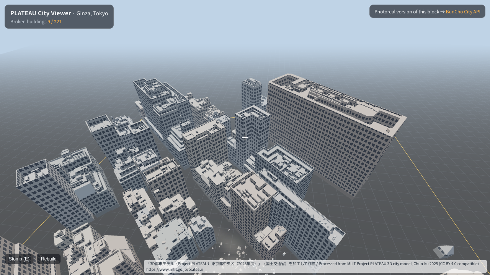

# PLATEAU City Viewer

**Play the full game: VOX — break real Tokyo as a kaiju, free in the browser → [bun-cho.work/kaiju](https://bun-cho.work/kaiju?utm_source=github&utm_medium=readme)** （遊べる版は VOX：[bun-cho.work/kaiju](https://bun-cho.work/kaiju?utm_source=github&utm_medium=readme)）

> **Want the photoreal version of this block?** The [BunCho City API](https://bun-cho.work/developers/city?utm_source=github&utm_medium=readme) returns a Gaussian-splat city aligned to the same PLATEAU buildings, with one collision mesh per building. **300 DREAM per 400 m × 300 m block**, price check is free. For agents: [city.md](https://bun-cho.work/docs/agents/city.md) · [llms.txt](https://bun-cho.work/llms.txt)
>
> 高精細な街は BunCho API で（1区画 400m×300m 300 DREAM〜、見積もりは無料）→ [街の 3D 生成 API](https://bun-cho.work/developers/city?utm_source=github&utm_medium=readme)

Load buildings from Japan's open [PLATEAU](https://www.mlit.go.jp/plateau/) 3D city models into three.js, walk the streets, and break buildings one at a time.

**Try it:** `npm install && npm run dev` (a 400 m × 300 m block of Ginza, Tokyo). The old hosted demo URL now forwards to VOX.



- Every PLATEAU building is its own breakable object with its own hit box, yet the whole city is one draw call.
- First-person walking with collision, roofs you can stand on, jumping and a fly mode. Works with touch.
- Shoot a building until it falls, or stomp an area. Chunks, dust and a collapse animation, all procedural.
- A converter that cuts a block out of any PLATEAU building 3D Tiles set (LOD1 or LOD2, Draco or not).
- No server, no build step for the data at runtime: one JSON file per city.

## Quick start

```sh
npm install
npm run dev
# open http://localhost:5173/
```

Controls are always shown at the bottom right of the screen (English / 日本語, switch with the button at the bottom left): click to start, `WASD` walk, `Shift` run, `Space` jump, `F` fly, left click shoot, right click or `E` stomp, `Esc` release the mouse. On phones: drag on the left half to walk, on the right half to look, tap to shoot.

## Your own city

1. Find a building tileset in the PLATEAU data catalog:
   ```sh
   curl -s https://api.plateau.reearth.io/datacatalog/plateau-datasets \
     | jq -r '.datasets[] | select(.type_en=="bldg" and .format=="3D Tiles") | [.id, .name, .url] | @tsv' | grep 13104
   ```
2. Convert a block around a point:
   ```sh
   npm run convert -- \
     --tileset "<tileset.json URL>" \
     --lat 35.6938 --lon 139.7034 --width 400 --depth 300 \
     --name "Shinjuku" \
     --attribution "「3D都市モデル（Project PLATEAU）東京都新宿区（20XX年度）」（国土交通省）（https://www.mlit.go.jp/plateau/open-data/）を加工して作成" \
     --out public/data/shinjuku.city.json
   ```
   Pass `--tileset` twice when the block crosses a ward boundary.
3. Open `http://localhost:5173/?city=./data/shinjuku.city.json`.

## Use it in your own three.js app

```js
import { City } from './src/city/City.js';
import { Debris } from './src/city/Debris.js';
import { WalkControls } from './src/controls/WalkControls.js';

const city = new City(await (await fetch('ginza.city.json')).json());
scene.add(city.mesh);

const debris = new Debris(scene, { groundAt: (x, z) => city.grid.groundAt(x, z) });
city.on('collapse', (i, b) => debris.collapseBurst(b));

// hit whatever the ray touches
const hit = city.pick(raycaster);          // { bid, point, normal } or null
if (hit) city.damage(hit.bid, 1, camera.position);

// or an area: a footstep, an explosion…
city.damageSphere(point, 20, 5);

// each frame
city.update(dt, time); debris.update(dt);
```

`city.grid.groundAt(x, z)` returns the roof height (or 0 on the street) and is what the walking camera collides with.

## How it works

- **One mesh, per-building state in a texture.** Each vertex stores its building index. A small float texture holds, per building, collapse progress, alive flag, hit flash and fall direction. The vertex shader reads it, so starting a collapse writes four floats instead of re-uploading geometry.
- **Height grid.** Building footprints and roof heights are rasterised into a 1 m grid. Walking, standing on roofs, debris landing and "free spot" search all read it. A falling building clears its cells.
- **Converter.** Walks the tileset (leaf tiles, since PLATEAU uses REPLACE refinement), decodes b3dm / glTF / Draco, splits triangles by `_BATCHID`, converts ECEF to local east-north-up metres and keeps `uro:buildingID`, `bldg:measuredHeight` and `bldg:usage`.

## Photoreal cities with the BunCho API (paid)

The viewer shows PLATEAU's massing models. The BunCho City API turns the same
block into a photoreal Gaussian-splat scene that lines up with each building,
plus collision meshes, building info and alignment.

```sh
export BUNCHO_API_KEY=bk_live_...     # https://bun-cho.work/studio/developers
node examples/sdk-node.mjs            # lists districts and prices a block (free)
node examples/sdk-node.mjs --generate # builds it (300 DREAM per block)
```

`src/sdk/buncho-city.js` is a small client (`listLocations`, `estimate`, `generate`, `job`, `download`). Keep the key on a server; never ship it to the browser.

## Data and licenses

- Code: MIT (`LICENSE`).
- Demo data: 「3D都市モデル（Project PLATEAU）東京都中央区（2025年度）」（国土交通省）（https://www.mlit.go.jp/plateau/open-data/）を加工して作成. PLATEAU data is offered under the PLATEAU site policy (PDL 1.0, compatible with CC BY 4.0), commercial use included. Keep the source and the "processed" note with any city you publish. Using the data to carry out a survey needs approval under the Survey Act; see `ATTRIBUTION.md`.
- three.js (MIT), Vite (MIT), draco3d (Apache-2.0, converter only).

This project is not affiliated with or endorsed by MLIT or Project PLATEAU.

---

Made by [Industrial Dream Inc.](https://bun-cho.work/about) (AI BunCho). Contributions welcome.
